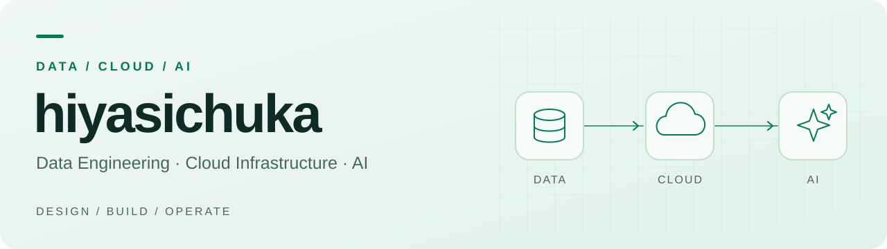
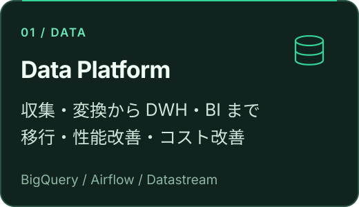
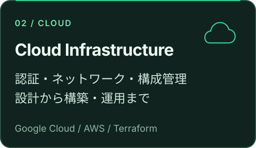
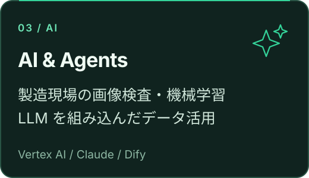

  <picture>
    <source media="(prefers-color-scheme: dark)" srcset="assets/profile/header-dark.svg" />
    <source media="(prefers-color-scheme: light)" srcset="assets/profile/header-light.svg" />
    
  </picture>

  <samp>
    <a href="https://zenn.dev/takaha4k">Zenn</a> ·
    <a href="https://qiita.com/takaha4k">Qiita</a> ·
    <a href="https://x.com/takaha4k">X</a> ·
    <a href="https://www.linkedin.com/in/takaha4k/">LinkedIn</a> ·
    <a href="mailto:hiyasichukahajimemasita@gmail.com">Email</a>
  </samp>

Google Cloud を中心とするデータ基盤の設計・開発・運用を軸に、クラウド基盤、Web アプリケーション、画像認識・LLM の活用まで取り組んできました。データの収集・変換、データウェアハウス（DWH）の性能・コスト改善、認証・ネットワーク設計から、本番導入後の運用までを経験しています。

  
  
  

   <code>Google Cloud</code>&nbsp;
   <code>Python</code>&nbsp;
   <code>TypeScript</code>&nbsp;
   <code>Terraform</code>&nbsp;
   <code>Docker</code>&nbsp;
   <code>GitHub Actions</code>

## 担当してきたこと

### データ基盤・データエンジニアリング

Google Cloud を中心とする全社データ基盤で、AWS からの移行、データを収集・変換するパイプラインの設計、DWH の性能・コスト改善、BI 環境の整備を担当してきました。認証・ネットワークを含む基盤全体の再構築も経験しています。

### クラウド・インフラ・アーキテクチャ

AWS・Google Cloud・Azure で、ネットワーク、認証・権限管理（IAM）、コンピュート、ストレージ、コンテナ、監視を組み合わせたシステムを設計・構築してきました。Terraform を使い、クラウドの構成をコードで管理する仕組みにも取り組んでいます。

### アプリケーション・Web 開発

工場向け業務システム、社内 Web サービス、新規サービス、データ基盤の関連ツールを開発してきました。要件整理、システム構成や API・データモデルの設計から、フロントエンド・バックエンドの実装、テスト、本番導入までを担当しています。

### CI/CD・開発生産性

GitHub Actions・CircleCI・Cloud Build で、コードレビュー、静的解析、自動テストを組み合わせた開発・リリースの仕組みを設計・運用してきました。インフラの構成管理も含め、開発から本番リリースまでの自動化と標準化に取り組んでいます。

### データベース・データストア

業務システム、Web サービス、データ基盤で RDB・NoSQL を利用してきました。アプリケーションで扱うデータの構造を設計し、DWH の設計・性能改善にも取り組んできました。

### AI・機械学習・LLM

製造現場の画像検査では、学習データの整備、画像処理、モデル開発、推論プログラムの実装から、実ラインへの導入・運用までを経験しています。近年は Vertex AI・Claude・Dify を使い、LLM を組み込んだデータ活用やエージェント開発にも取り組んでいます。

### その他の開発・プラットフォーム経験

SAP Analytics Cloud・SAP Data Warehouse、Firebase・Supabase・Hasura など、案件に応じて SaaS / PaaS を含む各種プラットフォームを利用してきました。

  
<strong>使用技術の一覧を見る</strong>

| 領域 | 使用してきた技術 |
|---|---|
| データ収集・変換・分析 | BigQuery、Cloud Composer / Airflow、Datastream、Dataflow、Dataform、Dataplex、dbt、Embulk、Digdag、Looker、Looker Studio、Tableau、QuickSight |
| クラウド・インフラ | Google Cloud、AWS、Azure、Terraform、Docker、Kubernetes、OpenShift、Cloud Run、ECS / Fargate、Lambda、Cloud Functions、VPC、IAM |
| アプリケーション・Web | Python、TypeScript、JavaScript、C#、Java、Kotlin、Flutter、Vue.js / Nuxt.js、React / Next.js、NestJS、Fastify、Express、FastAPI、.NET Framework |
| CI/CD・品質管理 | GitHub Actions、CircleCI、Cloud Build、GitLab、Playwright、Selenium、pytest、Jest、SQLFluff、Biome、ESLint、Prettier、Black |
| データベース | BigQuery、Oracle、SQL Server、MySQL、PostgreSQL、DynamoDB、MongoDB、Redis |
| AI・機械学習・LLM | TensorFlow、Keras、PyTorch、OpenCV、Optuna、CUDA / cuDNN、Vertex AI、Claude、Dify |
| その他のプラットフォーム | SAP Analytics Cloud、SAP Data Warehouse、Firebase、Supabase、Hasura、Heroku、Vercel、Tableau Server |

## 資格

| 分野 | 資格 |
|---|---|
| **Google Cloud** | Professional Data Engineer, Professional Cloud Developer |
| **AWS** | Solutions Architect Associate, Developer Associate, SysOps Administrator Associate |
| **国家資格** | 基本情報技術者, 応用情報技術者, 技術士補（情報工学） |
| **その他** | TOEIC 815, LSM / LSPO |

## 執筆

データ基盤や AI の設計・運用で取り組んだことを、[Zenn](https://zenn.dev/takaha4k)・[Qiita](https://qiita.com/takaha4k) に書いています。

| テーマ | ピックアップ記事 |
|---|---|
| AI・エージェント | [DMM のデータ分析エージェントのセッション管理](https://zenn.dev/dmmdata/articles/agent-platform-session-management) |
| データ基盤の刷新 | [Managed Airflow Gen 3 への移行](https://zenn.dev/dmmdata/articles/airflow-gen-2-to-3-migration) |
| データ収集 | [ペタバイト規模の DMM データ基盤で Embulk をやめた話](https://zenn.dev/dmmdata/articles/embulk-to-dlt-migration) |

## Contact

[X](https://x.com/takaha4k) · [LinkedIn](https://www.linkedin.com/in/takaha4k/) · [Email](mailto:hiyasichukahajimemasita@gmail.com?subject=Came%20from%20Github)

## GitHub Activity

<picture>
  <source media="(prefers-color-scheme: dark)" srcset="https://raw.githubusercontent.com/hiyasichuka/hiyasichuka/profile-assets/github-snake-dark.svg" />
  <source media="(prefers-color-scheme: light)" srcset="https://raw.githubusercontent.com/hiyasichuka/hiyasichuka/profile-assets/github-snake.svg" />
  
</picture>
